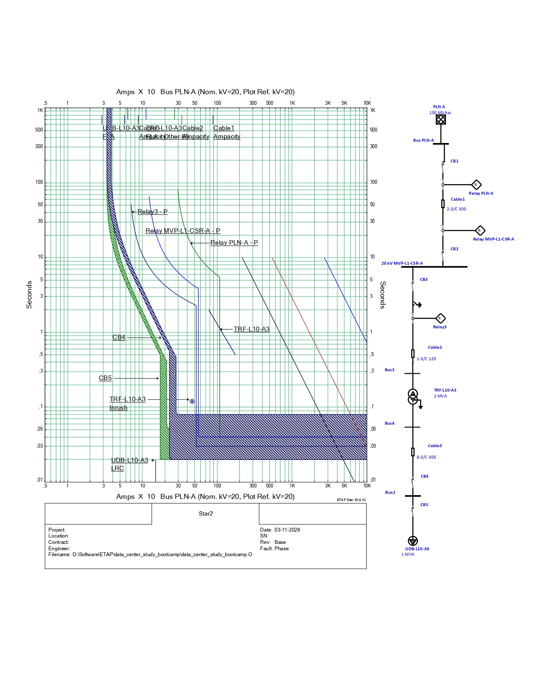
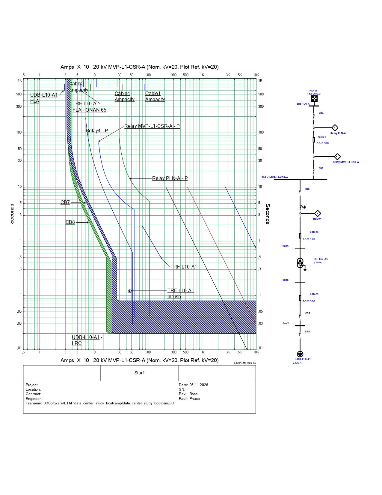
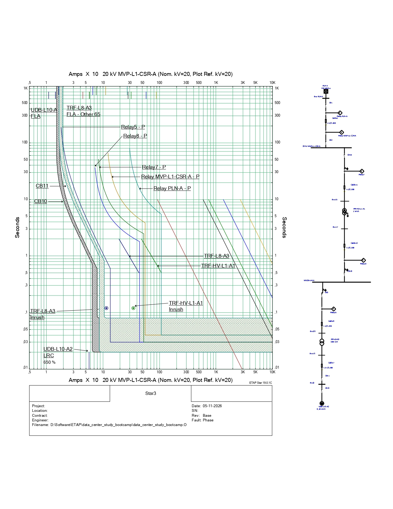
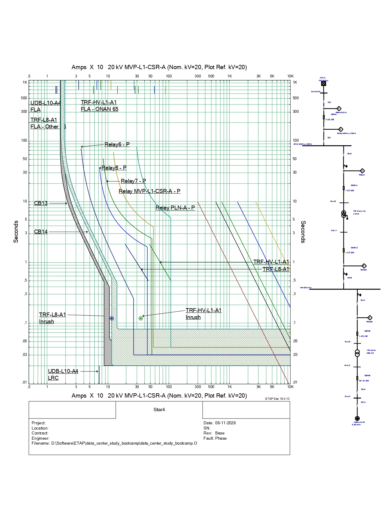
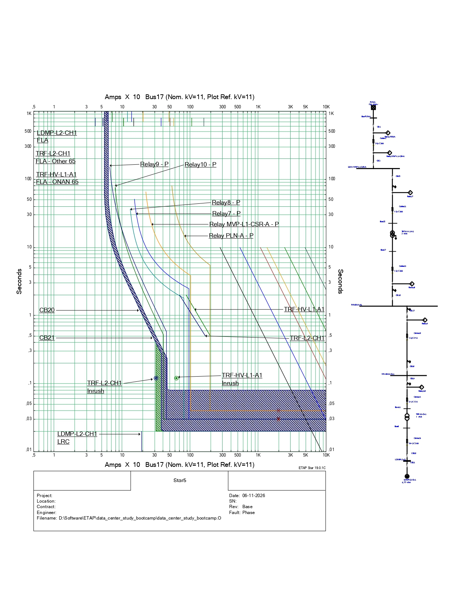

# Mission-Critical Data Center (2.77 MVA): Power Distribution & Protection Coordination

**Author:** Naufal Afrizal

**Role:** Electrical Design Engineer (Protection)

**Tools Used:** ETAP

## 1. Executive Summary & Facility Parameters
This project demonstrates the design and validation of an electrical power distribution system for a **2770 kVA Mission-Critical Data Center**. Unlike standard commercial buildings, data centers demand uncompromising power reliability and high availability. The primary focus of this study is to engineer a highly selective protection coordination scheme. The goal is to ensure that any localized fault (e.g., at a server rack PDU, UPS, or precision cooling unit) is cleared instantaneously by the nearest downstream device, preventing cascading outages that could disrupt facility-wide IT operations.

<!-- **Key Engineering Standards:**
*   **IEEE 242 (Buff Book):** Guidelines for Protection and Coordination of Industrial and Commercial Power Systems.
*   **IEC 60909:** Short-circuit current calculations in three-phase AC systems.
*   **ANSI/TIA-942:** Telecommunications Infrastructure Standard for Data Centers (Power Reliability considerations). -->

## 2. Single Line Diagram (SLD) & Topology
The electrical topology receives utility power at the Medium Voltage level (20 kV) and distributes it through multiple complex MV zones before stepping down to Low Voltage (400V) for IT and mechanical loads. 

*> Note: The SLD illustrates the redundant MV loops, step-down transformers, and the placement of main utility and feeder relays.*

### 3. Short-Circuit Analysis & Equipment Rating Validation
A comprehensive short-circuit study was executed to determine the maximum prospective 3-phase and single-line-to-ground fault currents across all mission-critical buses.

**Equipment Rating Validation:**
*   Evaluated Low Voltage Circuit Breakers (LVCB) supplying the UPS and HVAC (CRAC) systems against extreme fault currents.
*   Verified that the selected LVCB **Interrupting Ratings (kA)** safely exceed the simulated fault currents, ensuring the thermal energy ($I^2t$) remains within the equipment's physical limits during a fault, preventing catastrophic breaker failure.

## 4. Time-Current Characteristic (TCC) Coordination Analysis
To prove the reliability of the design, the protection coordination was evaluated across 5 critical paths, tracing from the Incoming Utility (PLN) down to the specific end-user loads.

### 4.1. Path 1: Incoming PLN to Load UDB-L10-A3
**Status: SUCCESS (Total Selectivity Achieved)**
*   **Evaluation:** Complete discrimination is established from the downstream LVCB at UDB-L10-A3 up to the main utility relay. A strict Coordinating Time Interval (CTI) of >150ms is maintained.
*   **Transformer Protection:** The MV Relay curve safely bypasses the inrush current of the intermediate step-down transformer while remaining securely to the left of the transformer's thermal damage curve.
*   **Visual Proof:**
    

### 4.2. Path 2: Incoming PLN to Load UDB-L10-A1
**Status: SUCCESS (SSTU Short-Time Optimization)**
*   **Evaluation:** Initial overlap issues at the Low Voltage level were successfully resolved by upgrading the main LVCB to a Solid State Trip Unit (SSTU). By disabling the main LVCB's Instantaneous element and tuning the Short-Time delay (tsd) to 0.2s, faults at UDB-L10-A1 are cleared locally without tripping the upstream main breaker.
*   **Visual Proof:**
    

### 4.3. Path 3: Incoming PLN to Load UDB-L10-A2
**Status: SUCCESS (Thermal Limit Compliance)**
*   **Evaluation:** The protection scheme for this distribution path demonstrates absolute thermal safety. All relay and LVCB operational curves are positioned strictly below and to the left of the associated cable ampacity and damage curves, guaranteeing that fault currents are isolated before cable insulation degrades.
*   **Visual Proof:**
    

### 4.4. Path 4: Incoming PLN to Load UDB-L10-A4
**Status: SUCCESS (Multi-Tier MV Grading)**
*   **Evaluation:** This path involves multi-stage grading through several Medium Voltage buses. The Time Dial settings across the upstream and downstream MV relays are perfectly staggered. This ensures that any severe bolted fault at the UDB-L10-A4 level is cleared instantly by the LVCB, with the MV relays acting as a reliable, delayed backup.
*   **Visual Proof:**
    

### 4.5. Path 5: Incoming PLN to Mechanical Load LDMP-L2-CH1
**Status: SUCCESS (Motor Starting Immunity)**
*   **Evaluation:** Unlike static IT loads, this path supplies a heavy mechanical Chiller (Motor Load). The coordination is highly successful; the protective devices are precisely calibrated to sit to the **right** of the Chiller's extreme starting current profile. This allows the heavy motors to start up seamlessly without triggering nuisance trips, while still protecting against locked-rotor or short-circuit events.
*   **Visual Proof:**
    

## 5. Protection Setting Configuration (Utility & Feeders)
The following are the finalized, field-ready protection settings for the Main Incoming Utility Relay, calibrated based on the ETAP simulation, correcting legacy design paradoxes to align with actual utility contracts.

### Main Incoming Relay (Relay PLN-A)
| Element | Parameter | Setting Value | Primary Ampere |
| :--- | :--- | :--- | :--- |
| **Global** | **CT Ratio** | **150 / 5 A** | - |
| **Phase (ANSI 51)** | Curve Type | IEC Normal Inverse | - |
| | Tap (Pickup) | 1.8 A | 270 A |
| | Time Dial / Multiplier | 0.1 | - |
| **Phase (ANSI 50)** | Instantaneous Pickup | 7.2 A | 1080 A |
| | Instantaneous Delay | 0.04 s | - |

## 6. Engineering Challenges & Problem Solving
During the simulation phase, several critical coordination conflicts were identified and resolved using first-principles engineering:
1.  **Utility Capacity vs. Contract Paradox:** Discovered a flaw in the legacy parameters where the combined physical capacity of all transformers (including a 10 MVA standby loadbank) vastly exceeded the utility contract setting (~80A). Resolved this by designing the Main Relay (MVP) to isolate non-concurrent loads, allowing the Utility Relay to be properly graded without causing facility-wide blackouts during peak IT demand.
2.  **Mitigating Critical Thermal Energy Warnings:** Fault analyses at high-capacity buses triggered thermal limit violations on downstream breakers. Mitigated by activating and meticulously tuning the **Instantaneous (Ii)** element on downstream trip units to bypass delay timers, extinguishing the arc before thermal damage occurred.