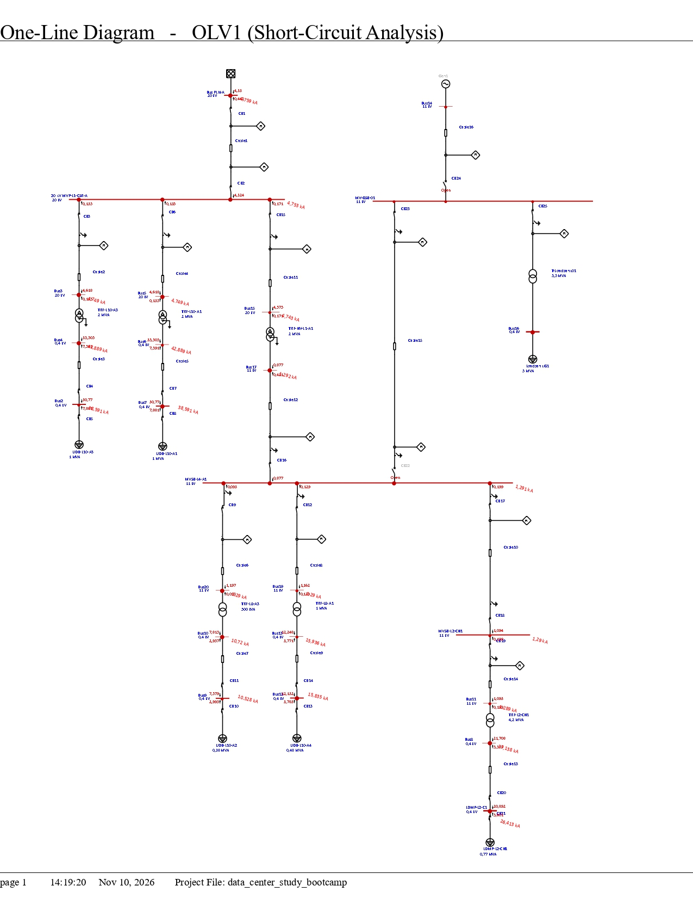

# Mission-Critical Data Center (2.77 MVA): Power Distribution & Protection Coordination

**Author:** Naufal Afrizal

**Role:** Electrical Design Engineer (Protection)

**Tools Used:** ETAP

## 1. Executive Summary & Facility Parameters
This project demonstrates the design and validation of an electrical power distribution system for a **2770 kVA Mission-Critical Data Center**. Unlike standard commercial buildings, data centers demand uncompromising power reliability and high availability. The primary focus of this study is to engineer a highly selective protection coordination scheme. The goal is to ensure that any localized fault (e.g., at a server rack PDU, UPS, or precision cooling unit) is cleared instantaneously by the nearest downstream device, preventing cascading outages that could disrupt facility-wide IT operations.

<!-- **Key Engineering Standards:**
*   **IEEE 242 (Buff Book):** Guidelines for Protection and Coordination of Industrial and Commercial Power Systems.
*   **IEC 60909:** Short-circuit current calculations in three-phase AC systems.
*   **ANSI/TIA-942:** Telecommunications Infrastructure Standard for Data Centers (Power Reliability considerations). -->

## 2. Single Line Diagram (SLD) & Topology
The electrical topology receives utility power at the Medium Voltage level (20 kV) and distributes it through multiple complex MV zones before stepping down to Low Voltage (400V) for IT and mechanical loads. 

*> Note: The SLD illustrates the redundant MV loops, step-down transformers, and the placement of main utility and feeder relays.*

## 3. Short-Circuit Analysis & Equipment Rating Validation
A comprehensive short-circuit study was executed to determine the maximum prospective 3-phase and single-line-to-ground fault currents across all mission-critical buses. 

**Equipment Rating Validation:**
*   Evaluated Low Voltage Circuit Breakers (LVCB) supplying the UPS and HVAC (CRAC) systems against extreme fault currents.
*   Verified that the selected LVCB **Interrupting Ratings (kA)** safely exceed the simulated fault currents, ensuring the thermal energy ($I^2t$) remains within the equipment's physical limits during a fault, preventing catastrophic breaker failure.

## 4. Time-Current Characteristic (TCC) Curves
Selective coordination was achieved by carefully plotting and adjusting the TCC curves of upstream and downstream devices to ensure maximum uptime for unaffected data hall zones.

**Coordination Philosophy:**
*   **Transformer & Motor Starting Immunity:** MV Relay curves are positioned strictly to the **right** of the Transformer Magnetizing Inrush points and heavy mechanical (Chiller) starting curves to prevent nuisance tripping during facility black-starts.
*   **Thermal Protection Limits:** All protection curves are maintained strictly to the **left and below** the Transformer and Cable Damage Curves to ensure rapid fault clearing before thermal destruction limits are breached.

## 5. Protection Setting Configuration (Utility & Feeders)
The following are the finalized, field-ready protection settings for the Main Incoming Utility Relay, calibrated based on the ETAP simulation and utility grid requirements.

### Main Incoming Relay (Relay PLN A)
| Element | Parameter | Setting Value | Primary Ampere |
| :--- | :--- | :--- | :--- |
| **Global** | **CT Ratio** | **150 / 5 A** | - |
| **Phase (ANSI 51)** | Curve Type | IEC Normal Inverse | - |
| | Tap (Pickup) | 1.8 A | 270 A |
| | Time Dial / Multiplier | 0.1 | - |
| **Phase (ANSI 50)** | Instantaneous Pickup | 7.2 A | 1080 A |
| | Instantaneous Delay | 0.04 s | - |
| **Ground (ANSI 51N)**| Curve Type | IEC Normal Inverse | - |
| | Tap (Pickup) | 0.4 A | 60 A |
| | Time Dial / Multiplier | 0.09 | - |
| **Ground (ANSI 50N)**| Instantaneous Pickup | 2.0 A | 300 A |

### Low Voltage Circuit Breakers (Solid State Trip Units)
| Device Level | Long-Time (Ir, tr) | Short-Time (Isd, tsd) | Instantaneous (Ii) |
| :--- | :--- | :--- | :--- |
| **Main LVCB (Upstream)** | [Insert Value] | [Insert Value] | OFF / [Insert Value] |
| **IT Rack/UPS Feeder** | [Insert Value] | [Insert Value] | [Insert Value] |

## 6. Sequence of Operation & Selectivity Proof
To validate the critical coordination, downstream faults were simulated using ETAP's Sequence of Operation module.

**Selectivity Achievements:**
*   Maintained a strict **Coordinating Time Interval (CTI)** between series LVCBs, successfully clearing downstream faults locally (e.g., at a specific server room PDU) without tripping the Main LV Breakers.
*   Ensured uninterrupted power delivery to parallel UPS units and active cooling systems during a localized short circuit.

## 7. Engineering Challenges & Problem Solving
During the simulation phase, several coordination conflicts were identified and resolved using first-principles engineering:
1.  **Eliminating Sympathetic Tripping in Critical IT Paths:** Initial simulations showed upstream LVCBs tripping simultaneously with downstream devices during high-kA faults. This was resolved by re-calibrating the **Short-Time delay bands (tsd)**, ensuring a proper margin for mechanical clearing, thereby restoring full isolation and selectivity.
2.  **Mitigating Critical Thermal Energy Warnings:** Fault analyses at high-capacity buses triggered thermal limit violations on downstream breakers. This was mitigated by activating and meticulously tuning the **Instantaneous (Ii)** element on the trip units to bypass delay timers, instantly extinguishing the arc before thermal damage occurred to the switchgear.